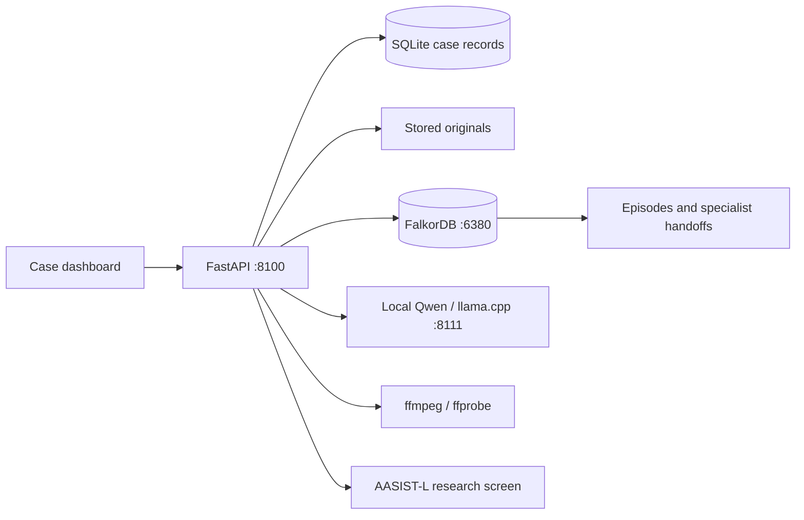

# Forensic Atlas

### Follow the evidence. Preserve the context. Review every claim.

An evidence-linked digital forensics workspace combining persistent case records,
FalkorDB agent memory, local Qwen summaries, measured media inspection, and cited
report drafts. Investigate sources, inspect relationships, coordinate specialist
tools, and review every generated statement in one dashboard.

**Python · FastAPI · SQLite · FalkorDB · llama.cpp · Qwen3.5-2B · JavaScript**

## What works today

| Workflow | Implemented behavior |
| --- | --- |
| Evidence intake | Streamed upload limits, SHA-256 hashing, stored originals and case-scoped retrieval |
| Case workspace | Evidence library, coverage, timeline review, relationship explorer and audit history |
| Graph reasoning | Bounded FalkorDB paths with source filtering and verified outputs |
| Agent coordination | Deterministic specialists, review triage, persistent episodes and versioned handoffs |
| Cited summaries | Local Qwen selects fact IDs; rendering copies exact verified statements and citations |
| Media inspection | Bounded ffprobe metadata, seekable playback and measured PCM waveforms |
| Audio research | Windowed AASIST-L screening with explicit research limitations |
| Reports | Immutable snapshots, content hashes, printable HTML and source-linked JSON |

The local model runs on the host. No training step or hosted LLM API is required
for the application's summary workflow. The standalone orchestrator in `tools/`
has separate configuration and is not required to run the application.

## Architecture



Qwen selects from bounded fact IDs. The verifier rejects unsupported selections
before the app creates an unreviewed draft. Graph-derived context retains its
source IDs and evidence state. Specialist labels describe tool responsibilities;
the coordinator uses deterministic rules rather than independent LLM investigators.

## Run the full application

The current launcher targets **Windows x64** with Docker Desktop using Linux
containers. Install Python 3.11+, Git, Docker Desktop, and ffmpeg/ffprobe on PATH.
Model downloads require internet access during setup.

```powershell
git clone https://github.com/Aaditya252/Forensic-Atlas.git
cd Forensic-Atlas
python -m venv .venv
.\.venv\Scripts\Activate.ps1
python -m pip install -r backend/requirements-full.txt
python scripts/setup_phase2_model.py
python scripts/setup_audio_screen.py
powershell -ExecutionPolicy Bypass -File scripts/start_forensic_atlas.ps1
```

Open **http://127.0.0.1:8100/** for the landing page, then choose **Open Workspace** for the live dashboard, or use
**http://127.0.0.1:8100/cases.html** for the case library. A fresh installation
seeds the fictional Northstar case. Public case entries require their download
and import scripts; a source checkout does not include this laptop's cases.

Qwen setup fetches approximately 1.28 GB of pinned Q4_K_M weights and the Windows
CPU runtime. Manifests record revisions, checksums and provenance. Reserve disk
capacity for models, originals, graph persistence and backups. CPU latency
depends on the host and workload.

## Verify

```powershell
python -m unittest discover -s backend/tests -q
python scripts/deployment_preflight.py
```

The unit suite uses fake graph adapters and requires no live services. Preflight
checks pinned model assets, audio model loading, media tools, API readiness,
Qwen and graph connectivity. Run it after starting the full stack.
Additional workflow checks are in `scripts/verify_phase*.py` and
`scripts/verify_public_media_workflows.py`; some create disposable test records.

## Deployment and persistence

This is a stateful application. A static website deployment alone cannot run
Qwen, SQLite, FalkorDB or media processing. `landing-page/` is a separate
presentation site; publishing it does not deploy the backend.

For behavior closest to the laptop, use a persistent Windows x64 host with
the same models and services. Keep the API and model on loopback and use a
private SSH tunnel for remote access. See the [deployment guide](docs/DEPLOYMENT.md).

| Data | Location | In Git? |
| --- | --- | --- |
| Application and dashboard | `backend/`, `ui-prototype/` | Yes |
| Model metadata and licenses | `models/` | Yes |
| Model binaries and runtime | `*.gguf`, `*.pth`, `local-runtime/` | No; fetched by setup scripts |
| Case DB and originals | `cases/storage/` | No |
| Graph persistence and backups | `cases/graph-data/`, `cases/backups/` | No |
| Downloaded samples and corpora | `cases/public/`, `datasets/evaluation/` | No |
| Logs and generated outputs | `output/` | No |

Artifact paths in SQLite are absolute. Copying a database to a new root without
verified path migration breaks original retrieval. Never copy live SQLite or
FalkorDB persistence files as a backup.

## Scope and limitations

This is a development and research workspace, not a validated evidence vault.
Northstar records are fictional. AASIST-L scores are experimental audio
observations, not authenticity verdicts. Automatic speech transcription, PCAP
interpretation, cloud acquisition and validated visual deepfake detection are
not installed. Unsupported detector requests fail closed.

No deployed identity provider or case-scope authorization is configured. The
service intentionally binds to loopback. Public multi-user exposure requires a
reviewed authentication boundary, parser isolation, storage controls, and tested
backup and restoration before real case data is introduced.

## Explore the source

- [System map](docs/SYSTEM-MAP.md): modules, routes, data models and connections.
- [Backend guide](backend/README.md): API behavior, agent workflows and live checks.
- [Agent cards](backend/agents/AGENT_CARDS.md): roles and disabled capabilities.
- [Local summary design](docs/phase-2-local-summary.md): selection and verification.
- [Case guide](cases/README.md): sample provenance and import boundaries.
- [Third-party notices](THIRD_PARTY_NOTICES.md): models, runtime and dependencies.

## Contributing

Describe the affected workflow and verification. Preserve source IDs, evidence
states, audit events and fail-closed behavior. Never commit case originals,
credentials, local databases or model binaries. Run the unit suite before a pull
request and document live-service checks separately.

## License

Original project code is available under the [MIT License](LICENSE). Third-party
code, models and sample data retain their own licenses and notices.
