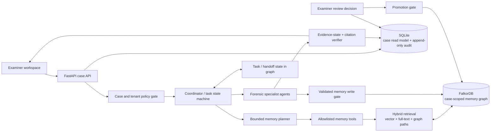

# SUTRAM Agent Memory & Coordination — Part 1

**Status:** Architecture proposal; not a report of a trained or evaluated model.  
**Research checked:** 18 October 2026.  
**Compute:** The prompt's GPU/serving line is a placeholder. Hardware, installed runtimes, and remaining deadline hours must be confirmed before any model download or training.  
**Hackathon scope:** The event page lists 15–18 October 2026; its rules require that FalkorDB materially shape the product rather than decorate results. A live demo/video is required by the supplied brief. The event URL/rules should be rechecked before submission.

The current SUTRAM workspace is still local development: it has no authentication provider, configured LLM, or validated media detector, and FalkorDB may be disconnected. The diagram below is the target architecture; a provider label or diagram does not claim that a service is deployed.

## 1. Product architecture

SUTRAM's memory is a case-scoped graph service shared by cooperating agents. FalkorDB is the source of truth for agent memory, handoffs, and graph-derived retrieval. SQLite remains the application’s existing case/read model and append-only audit store during the migration, but the `agent_memory` table is removed from the memory path after the graph cutover. The graph cannot be optional in the Track 02 demo: agent plans, retrieved context, state handoffs, and citations must change when graph contents change.

**Read path:** agent request → authenticate tenant, examiner, and case → planner chooses one bounded tool template → retrieve candidate episodes/facts/procedures/handoffs with provenance → filter by scope and review state → specialist prepares a cited draft → verifier checks source IDs, evidence state, and policy → return answer and explainable graph path.

**Write path:** tool result or examiner-approved action → validate schema, case scope, source IDs, evidence state, idempotency key, and optimistic version → write episode/handoff/candidate to FalkorDB → append audit event to SQLite. The write gate never promotes candidate/hypothesis to semantic fact. Only a new, append-only examiner review decision can authorize a new reviewed fact version; prior versions remain linked rather than overwritten.

This design responds to Track 02's episodic, semantic, and procedural memory, persistent conversation history, agent handoffs, concurrent access, and tenant separation requirements. FalkorDB documents OpenCypher property graphs, separate named graphs, vector/full-text/range indexes, and Python-client usage; these capabilities support the architecture but do not themselves provide SUTRAM's authorization or forensic policy controls ([official FalkorDB documentation](https://docs.falkordb.com/), [Graph Hacks brief](https://www.wemakedevs.org/hackathons/falkordb)).

## 2. Isolation and sharing boundary

| Scope | What is stored/shared | Isolation rule |
|---|---|---|
| Organisation / tenant | Tenant configuration and reviewed, generic procedures that contain no case evidence | Separate tenant graph namespace. No cross-tenant retrieval. |
| Investigation / case | Episodes, candidate facts, approved semantic facts, procedures learned for that case, tasks, handoffs, agent runs, and artifact references | Separate FalkorDB graph per case beneath a tenant-derived name; every node and query also carries tenant and case IDs. API derives the graph name from authenticated scope, never from a caller-supplied raw graph name. |
| Examiner / user | Case-scoped conversation turns and task ownership metadata needed for continuity | Each item records its owner/scope. It is visible to other examiners only when the case policy explicitly permits it. No cross-case personal memory is in scope. |
| Agent | Agent-run/episode metadata and handoff checkpoints | Agents share only via bounded graph tools within the authorized case. No agent-private graph can bypass case authorization. |
| Global | Public model/dataset manifests and synthetic benchmark fixtures | No real case data; versioned separately from tenant graphs. |

`tenant + case` boundaries are enforced at the API, tool, query-template, and test layers, not only through opaque graph names. Tenant-wide procedures must be explicitly approved as non-case-derived before sharing. Graph naming, identifier derivation, properties, indexes, and query templates are specified in Part 2.

## 3. Smallest defensible model slate

Do not train eleven independent models. Most M1–M11 responsibilities are policy, schema validation, graph operations, or deterministic scoring; model complexity should be added only where the synthetic benchmark demonstrates a measurable failure.

| Tier | Model/system | Tasks | Decision |
|---|---|---|---|
| **Tier 0 — demo now** | FalkorDB memory graph + deterministic write/read gates, fixed query templates, and evidence verifier | Persistence, sharing, graph-shaped retrieval, handoffs, candidate/fact separation, audit linkage | **Build now.** This demonstrates Track 02 without pretending a detector or LLM is trained. |
| **Tier 0 — retrieval** | `sentence-transformers/all-MiniLM-L6-v2` as an optional off-the-shelf text embedder; combine vector retrieval with FalkorDB full-text and bounded graph traversal | M4 semantic candidate recall | **Use only if it runs in the confirmed environment.** Model card currently reports Apache-2.0; no SUTRAM accuracy or latency result exists. Start with graph + keyword retrieval if setup fails. |
| **Tier 0 — optional generation** | `Qwen/Qwen3-4B` off-the-shelf, local-only, non-thinking mode, behind a JSON schema/constrained decoder and evidence verifier | Draft structured extraction, concise session summary, and handoff suggestions | **Optional and compute-gated.** Model card identifies 4B parameters and Apache-2.0. It enables thinking by default and documents a hard non-thinking switch; for extraction/routing, use non-thinking mode to avoid hidden reasoning tokens in a strict JSON channel. It remains advisory. |
| **Tier 1 — fine-tune after smoke** | One Qwen3-4B LoRA/QLoRA adapter, multitask examples for M2 extraction, M6 consolidation drafts, and M9 handoff suggestions | Reduce schema errors and improve SUTRAM-specific labels | **Conditional.** First verify GPU, memory, driver/runtime, training time, dataset licenses, and eval split. No training is claimed in this part. One shared adapter is the first experiment, not a promised result. |
| **Tier 1 — retrieval adaptation** | Keep MiniLM frozen; evaluate it against the synthetic SUTRAM benchmark, then consider contrastive fine-tuning | M4 episodic/fact/procedure retrieval | **Defer training** until measured retrieval failures justify it. No retrieval metric is claimed. |
| **Tier 2 — later only** | Separate reranker/entity-resolution cross-encoder, temporal contradiction/NLI model, and salience classifier | M1, M3, M5, M10 | **Do not train for tonight’s demo.** Add only if the benchmark shows these are current bottlenecks and data rights/compute allow. |

DeepSeek-R1-Distill-Qwen-7B is a real fallback candidate whose current Hugging Face repository reports MIT for the model files, but its repository is 15.2 GB and is not the default under unknown compute. Its lineage/license terms must be reviewed alongside the base-model terms before redistribution or fine-tuning ([model card](https://huggingface.co/deepseek-ai/DeepSeek-R1-Distill-Qwen-7B)). Qwen3-4B and MiniLM licensing/model details were checked in their current cards ([Qwen3-4B](https://huggingface.co/Qwen/Qwen3-4B), [MiniLM-L6-v2](https://huggingface.co/sentence-transformers/all-MiniLM-L6-v2)). These pages can change; Part 6 will pin revisions and record license text and access conditions before download.

### M1–M11 disposition

| ID | Initial implementation |
|---|---|
| M1 write gate / salience | Deterministic policy gates; no learned salience model in Tier 0. |
| M2 fact/relation extraction | Validated structured extractor; optional Qwen3-4B draft in Tier 0; LoRA experiment in Tier 1. Candidate/hypothesis state only. |
| M3 entity resolution | Exact IDs and conservative normalized-key match first; no person identity resolution. Separate model deferred. |
| M4 retrieval | FalkorDB vector + full-text + fixed graph-path tools; MiniLM optional. Each result includes the traversal/source path. |
| M5 update/contradiction | Append-only versioning and deterministic temporal checks first; an NLI model may flag a candidate contradiction later. Never overwrite or adjudicate. |
| M6 consolidation | LLM may draft episode/session summaries; summaries preserve source IDs and are not promoted to facts. Same Tier 1 adapter candidate. |
| M7 memory-read planner | Deterministic template selection and typed parameters; never free-form generated Cypher. |
| M8 procedural learner | Store examiner-reviewed procedure templates and outcome metadata; do not learn from unreviewed trajectories. |
| M9 handoff/routing | Deterministic coordinator state machine and bounded handoff payload; model may recommend, not dispatch or change permissions. |
| M10 importance/decay | Explicit deterministic recency/importance/relevance weights, versioned and explainable; no learned weights in the demo. |
| M11 safety | Deterministic PII/secret filters plus strict tenant/case allowlist and leak tests; a model cannot override the gate. |

## 4. Build versus reuse

| Choice | Decision | Reason / rule risk |
|---|---|---|
| FalkorDB Python client + parameterized Cypher | **Reuse** | Official client handles database connectivity; SUTRAM owns schema, scope enforcement, fixed query templates, versions, and audit. A client library is not the memory policy. |
| SUTRAM memory schema, promotion gate, handoffs, and benchmark | **Build** | These carry the forensic evidence-state and tenant/case policy that generic memory frameworks do not know. The graph must drive agent behavior and explain answer paths. |
| FalkorDB GraphRAG-SDK | **Reference; defer dependency** | Its current docs describe multi-path retrieval including vector/full-text/Cypher/relationship expansion and provenance. It is a general document GraphRAG pipeline; do not let it auto-extract or generate queries into evidentiary memory without SUTRAM's typed write gate and source/state verifier. Current repo reports Apache-2.0; pin and recheck before adoption ([SDK docs/repo](https://github.com/FalkorDB/GraphRAG-SDK)). |
| Graphiti, Cognee, LangChain, LlamaIndex | **Compare as references in Part 2; no dependency yet** | Their current versions, memory semantics, graph isolation, generated-query behavior, and licenses must be checked at the chosen revision. **VERIFY before use.** Any imported write/retrieval path must pass the same SUTRAM policy gateway. |
| MCP | **Use as a tool boundary if useful** | MCP can expose named, bounded memory tools to agents; it is not the memory database. Server-side case authorization and fixed tool schemas remain mandatory. Exact server/client versions **VERIFY** in implementation. |
| Vector/full-text index in FalkorDB | **Use if the installed server supports the pinned index/query features** | Official documentation lists vector and full-text indexes; Part 2 will pin the server/client version and verify exact syntax against that version. No vector benchmark is claimed. |
| Model-generated Cypher | **Reject for production memory reads/writes** | Planner emits one allowlisted operation plus validated parameters. A future read-only proposal can be parsed and checked against scope/schema before execution, but is not needed for the demo. |

## 5. Part 1 self-check

- No dataset, benchmark score, latency target, training run, or model evaluation is reported as completed.
- The selected model cards and FalkorDB capabilities are linked to their sources; exact runtime, dataset licenses, and index syntax are rechecked/pinned before use.
- Hardware is unknown; all GPU-dependent inference/training remains conditional.
- FalkorDB is the planned memory source of truth and shapes reads, writes, handoffs, and answer paths.
- Candidate/hypothesis memory cannot become semantic fact without examiner review; identity, intent, and causation conclusions are prohibited.

**Next:** Part 2 — FalkorDB memory and coordination design, including graph layout, retrieval, promotion, contradictions, decay, handoffs, idempotency, concurrency controls, and a measured load-test plan.
