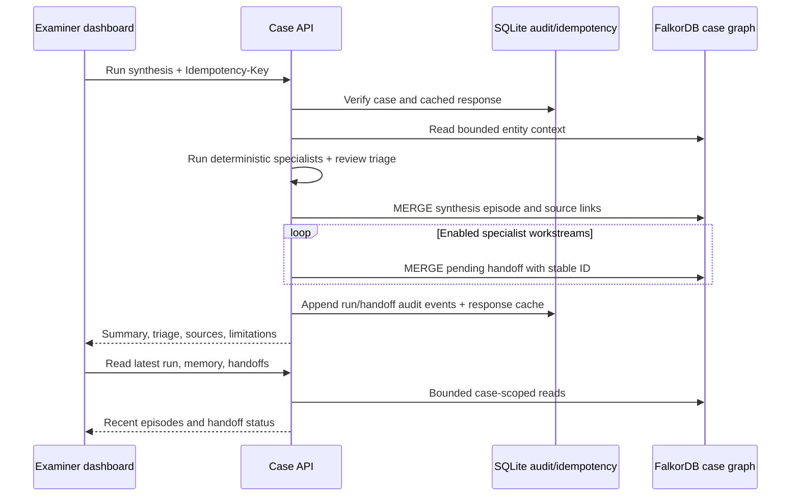

# SUTRAM Agent Memory & Coordination — Part 2

**Status:** Lightweight implementation slice added to the local development app. No benchmark, concurrency result, or production security review is claimed.

## 1. What now persists in FalkorDB

Each investigation uses its hashed per-case graph name. New nodes carry the case ID and use fixed labels:

| Label | Purpose | Key properties |
|---|---|---|
| `AgentEpisode` | Context query and case-synthesis history | `id`, `caseId`, `agentId`, `kind`, `summary`, `evidenceState`, JSON source IDs, payload, idempotency key, timestamp, version |
| `AgentRun` | Coordinator run associated with specialist work | `id`, `caseId`, coordinator, timestamp |
| `AgentHandoff` | Pending or acknowledged bounded work item | `id`, `caseId`, from/to agent, task, state, source IDs, context, status, version, timestamp |
| `AgentIdentity` | Stable agent endpoint in a case workflow graph | `id`, `caseId` |

The fixed relations are `SUPPORTED_BY` from an episode or handoff to known `CaseEntity` evidence, `HANDED_OFF_TO` from a source agent/run to a handoff, and `ASSIGNED_TO` from a handoff to its receiving agent. Relationship creation is parameterized and uses fixed query templates; no model generates Cypher. Existing graph projection nodes and edges remain unchanged.

SQLite remains responsible for the case snapshot, review decisions, write idempotency, and append-only audit events. New agent memories are not written to SQLite. The old `agent_memory` table remains only for compatibility; `scripts/migrate_agent_memory_to_falkordb.py` provides a dry-run-first, idempotent historical copy and adds a migration audit event.

## 2. Workflow

Context graph answers and coordinator summaries are episodic/unverified. They retain a state and case-known source IDs. The deterministic review triage orders existing review items by explicit type/title categories (source/parser dependency, clock quality, attribution, candidate link, media screening, general review). It ignores model confidence and does not approve, return, or close a review.

Coordinator runs create pending work for enabled `integrity-coverage`, `timeline-correlation`, `graph-context`, and `impact-assessment` workstreams. This is a handoff record, not a claim that an autonomous worker has executed. Receivers acknowledge with the handoff version they read; FalkorDB performs a compare-and-set from `pending` to `acknowledged` and increments the version. A stale acknowledgement returns a conflict.

## 3. Bounds and failure behavior

- Memory reads: at most 100 episodes; handoff reads: at most 100.
- Context graph traversal remains at depth 1–3 and 25 paths.
- Source IDs are checked against the current case evidence list before a handoff; graph-store input also restricts identifiers to artifact-ID syntax.
- Graph write IDs derive from case ID and idempotency key. Replaying a successful request returns its cached SQLite response; replay after a partial graph/SQLite failure MERGEs the same graph IDs.
- FalkorDB unavailable or memory write failure returns an explicit 503. No disconnected synthetic run is returned as a successful persisted workflow.
- A graph write and a SQLite audit write are not a distributed transaction. Stable graph IDs make graph retries safe; audit de-duplication for ordinary API retries uses the response idempotency record. Operational reconciliation is still required for abrupt process failure between stores.
- No semantic fact promotion or automatic forgetting is implemented. No tenant/user authentication is implemented; the current boundary is per case in a loopback-only development app.

## 4. API surface

See `ui-prototype/BACKEND_CONTRACT.md` for request and response envelopes:

- `POST /api/v1/cases/{caseId}/agents/hub/run` — deterministic synthesis, triage, graph episode, and specialist handoffs.
- `GET /api/v1/cases/{caseId}/agents/hub` — latest synthesis, providers, roster, recent episodes, and handoffs.
- `GET /api/v1/cases/{caseId}/agents/memory` — bounded episode read.
- `GET/POST /api/v1/cases/{caseId}/agents/handoffs` — list or create a bounded handoff.
- `POST /api/v1/cases/{caseId}/agents/handoffs/{handoffId}/ack` — optimistic acknowledgement.
- `GET /api/v1/cases/{caseId}/agents/review-triage` — deterministic open-review order.
- `POST /api/v1/cases/{caseId}/context/ask` and `GET .../context/memory` — source-filtered graph context and episodic history.

## 5. Still deferred

This slice uses no LLM or embedding model. It does not provide vector indexes, semantic consolidation, examiner-reviewed semantic promotion, procedural learning, retention/forgetting policy, durable worker retries, or multi-tenant authentication. The existing SQLite schema still includes the legacy memory table; after historical migration and a separately reviewed compatibility window, a later migration can remove it. Load targets are not yet measured, and the case graph is not a substitute for immutable evidence storage.

**Self-check:** no dataset or model result is claimed; no training occurred; candidate/hypothesis items remain non-findings; handoffs require acknowledgement; source references are filtered; graph unavailability fails closed.

**Part 2 implementation slice complete.** Part 3's lightweight agent decisions and timestamp/review workflows are recorded in `part-3-lightweight-agents.md`.
